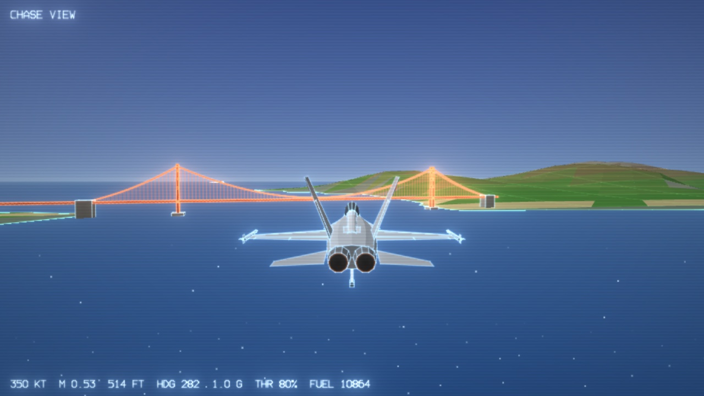
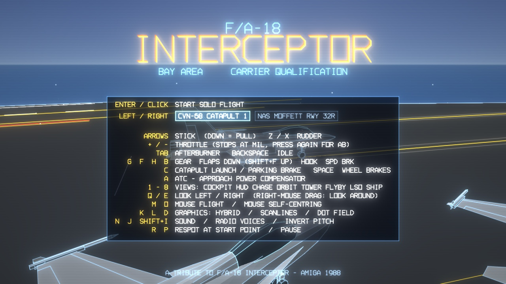
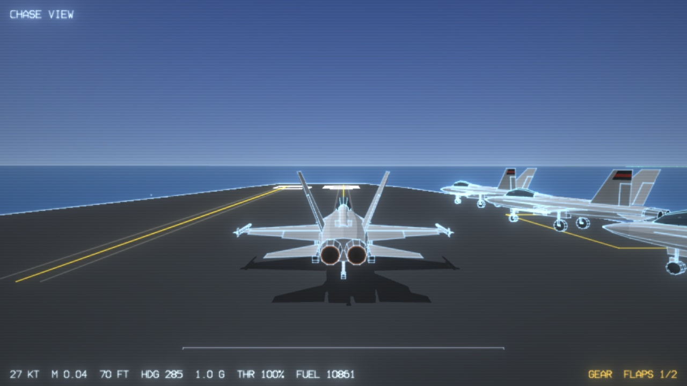
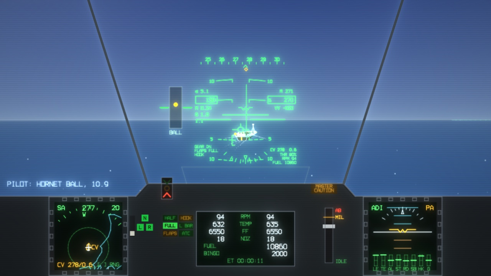
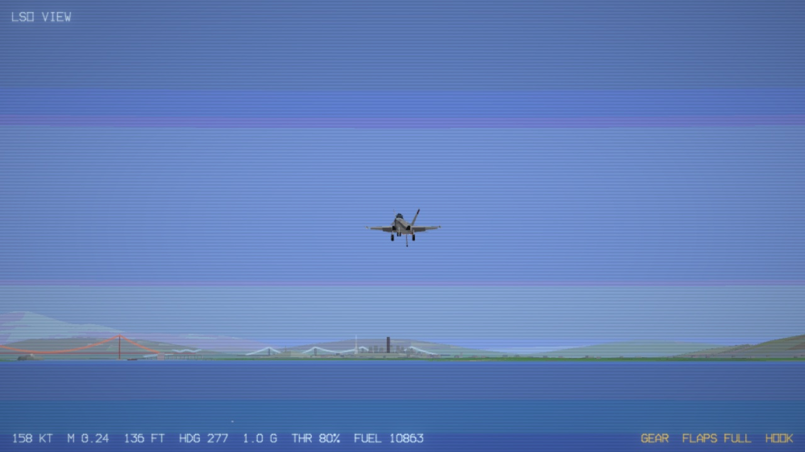

# INTERCEPTOR // BAY AREA

A WebGL tribute to **F/A-18 Interceptor** (Intellisoft / Electronic Arts, Amiga 1988):
solo flight from a Nimitz-class carrier off San Francisco, with a modern take on the
Amiga's flat-shaded polygons, glowing vector lines and the Paula sound chip.

No build step, no dependencies - plain ES modules + raw WebGL2 + Web Audio.



| | |
| --- | --- |
|  |  |
| Title screen - pick CVN-68 or NAS Moffett | Catapult 1, run up to MIL and salute |
|  |  |
| In the groove: HUD, ICLS, ball repeater and DDIs | LSO view in the AMIGA OCS graphics mode |

## Run

ES modules need to be served over HTTP (not `file://`):

```sh
cd fa18-game
python3 -m http.server 8000      # or: npx serve .
# open http://localhost:8000
```

Click to "insert the disk" (this also unlocks audio), pick a start point with the arrow keys
(CVN-68's catapult or NAS Moffett Field runway 32R), then press **Enter** to fly.

## Flying

| Key | Action |
| --- | --- |
| Arrows | Stick (Down = pull, Up = push). Hold Shift for fine control |
| Z / X | Rudder (nose-wheel steering on deck) |
| `+` / `-` (or PgUp/PgDn, mouse wheel) | Throttle. It stops at MIL; press again for afterburner |
| Tab / Backspace | Afterburner on/off / throttle to idle |
| G F H B | Gear, flaps down a notch (Shift+F = up a notch), tailhook, speed brake |
| C | Salute the catapult officer (launch); on land, parking brake off / on |
| Space | Wheel brakes |
| A | ATC - approach power compensator (auto-throttle holding 8.1° AoA) |
| 1 - 8 (or V to cycle) | Cockpit, HUD-only, chase, orbit (mouse drag/wheel), tower, fly-by, LSO, carrier |
| Q / E, right-mouse drag | Look left / right / around from the cockpit |
| \` (backquote) | Performance overlay (FPS, physics/render ms, draw calls, resolution scale) |
| [ ] | Tactical map range |
| M / O | Mouse flight (the Amiga original's mouse-as-stick) / self-centring on/off |
| D | Ground dot field on/off (the original's low-altitude cue for landing by eye) |
| K / L | Graphics: HYBRID, AMIGA OCS (12-bit palette, copper skies), VECTOR / scanlines |
| N / J / Shift+I | Sound / radio voices / invert pitch (default: Down arrow = nose up) |
| R | Respot at the start point - catapult 1 or Moffett runway 32R (refuels) |
| P / Esc | Pause (shows your LSO grades and boarding rate) |

Gamepads work too (left stick = stick, right stick = rudder, triggers = throttle,
A launch, B hook, X flaps, Y gear, LB speed brake, RB brakes, Back = view, Start = pause).

### Catapult launch
You start on cat 1 with flaps HALF. Run the throttle up to MIL (wait for ~100% RPM),
then press **C**. The steam catapult takes you to ~160 kt in 94 m; hands off - the
FCS rotates to fly-away attitude. Gear up (G) and flaps up (Shift+F) once climbing,
then accelerate - with flaps down the FCS stays in the low-speed approach mode (22° AoA limit,
gentler g) until the flaps blow up automatically at 250 kt.
Forget the flaps and you'll find out what a cold shot feels like.

### Field take-off (NAS Moffett)
You start lined up on runway 32R (9,200 ft) with the parking brake set and flaps HALF. Throttle
to MIL, press **C** to release the brakes and keep straight with Z / X (there's ~10 kt of
crosswind from the left). At ~145 kt ease the stick back: the nose rotates at ~6°/s to 10-12°
pitch and the jet flies off at ~155 kt after ~1,750 ft (~1,100 ft in afterburner). Moffett is
40 nm south-east of the carrier - Hangar One makes a good landmark - and its runways also work
for landing: gear and flaps down, hook up, ~135 kt, brakes (Space) after touchdown.

### Carrier landing (Case I)
1. Come up the starboard side at 800 ft, break left over the bow.
2. Downwind at 600 ft: **gear down, flaps FULL, hook down (G, F F, H)**. Slow to on-speed
   AoA: amber donut on the AoA indexer, velocity vector centred in the E-bracket (8.1°).
3. Turn in at the 180, roll out behind the ship ~3/4 nm. The angled deck points 9°
   left of the ship's heading **and slides to the right** as the ship steams - keep
   correcting lineup.
4. Fly the ball (lens repeater left of the HUD, ICLS needles in the HUD):
   *throttle controls the glideslope, stick controls AoA and lineup*. Press **A** for ATC if you like.
5. No flare. At touchdown go to full power - if you miss the wires you bolter and fly away.
6. Trapped: the LSO grades the pass ("OK 3-WIRE (LO)X F IC"). H raises the hook, R respots.

Watch out for the burble behind the island in close, and don't go below the ramp.

## What's simulated

* **6-DOF rigid body** at 240 Hz with F/A-18C mass, inertia (with fuel burn) and geometry.
* **Aerodynamics:** non-linear lift to 90° AoA with the LEX high-alpha lift peak (CLmax ≈ 1.7 @ 35°),
  compressibility, transonic drag rise, induced drag, flaps, gear, speed brake, ground effect,
  pitch/roll/yaw stability and damping derivatives, loss of directional stability at extreme AoA.
* **Two F404-GE-402s:** spool-up lag, afterburner light-off, thrust lapse with altitude/Mach,
  real specific fuel consumption (10,860 lb of fuel lasts ~10 min in max AB), flameout.
* **Fly-by-wire:** non-linear dynamic inversion control laws - g command with neutral-stick
  flight-path hold (UA), AoA-limited approach mode (PA). At low speed the stick position
  effectively commands AoA (neutral stick won't hold more than 12°/18°), so the jet is
  speed-stable and noses over instead of hanging on the limiter; 220°/s roll-rate command, sideslip
  suppression. The FCS can only use real stabilator/aileron/rudder throws and rates, so its
  authority fades with dynamic pressure just like the jet. Flaps blow back to AUTO above 250 KCAS.
* **Landing gear:** oleo struts with progressive springs and orifice damping, slip-angle tyre
  model, brakes, nose-wheel steering; gear collapses above ~27 ft/s sink.
* **Carrier ops:** moving & pitching deck (14 kt into a 12 kt wind), steam catapult, 4 arresting
  wires with an arresting-engine model (hook must be on deck; ~100 m run-out), bolters, ramp strikes,
  IFLOLS ball, LSO calls, wave-offs and pass grading.
* **Atmosphere:** ISA, wind with boundary-layer shear, turbulence, and the carrier airwake "burble".

Validated against reference performance (run `node tools/fmtest.mjs`; `tools/landing.mjs` and
`tools/runway.mjs` cover approach speeds and field take-off):
Mach 0.95 MIL / 1.10 AB at sea level, Mach 1.69 at 36,000 ft, ~47,000 fpm max climb,
220°/s roll, 7.5 g, 132 KCAS on-speed approach at ~79% RPM.

## Files

```
js/main.js         game loop, views, environment, warnings
js/flightmodel.js  F/A-18 physics + FCS + gear + catapult/arrestment
js/carrier.js      CVN-68: deck, wires, lens, model
js/lso.js          landing signal officer + grading
js/gl.js           WebGL2 renderer (vector lines, log depth, MRT bloom, OCS palette)
js/terrain.js      Bay Area terrain from real coastline coordinates (js/geo.js)
js/scenery.js      bridges, skyline, Alcatraz, airfields, collision boxes
js/hornet.js       animated Hornet model
js/hud.js          HUD;  js/cockpit.js  DDIs and panel
js/audio.js        Paula-style 8-bit sampled sound;  js/music.js  4-channel tracker tune
```
